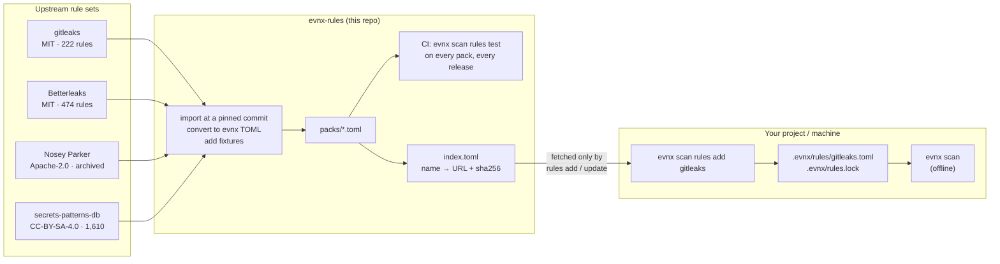
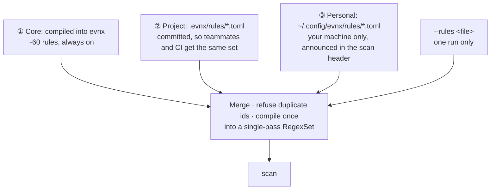
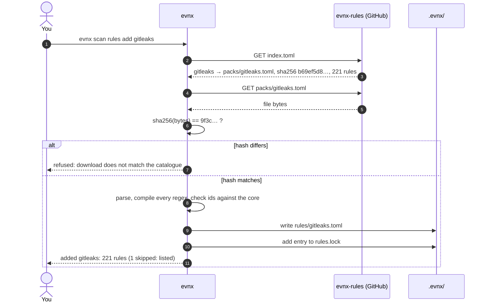
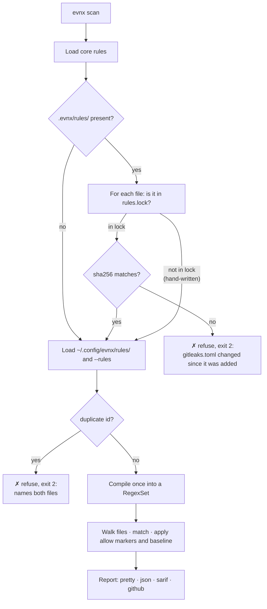
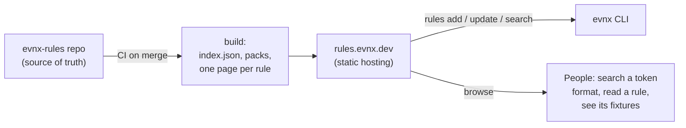

# evnx-rules

The rule catalogue for [`evnx scan`](https://github.com/urwithajit9/evnx): optional,
tested packs of secret-detection rules that you add to a project or to your own
machine, on request, and that evnx checks byte for byte before every scan.

> ⚠️ **Status: works with evnx v0.13.0, which is not released yet.** The first pack,
> `gitleaks`, is here and `evnx scan rules add gitleaks` fetches it, but only an evnx
> built from `main` has that command until the v0.13.0 release. Sections below that
> say *planned* were the design; the importer table and the layout reflect what was
> built.

---

## Contents

- [Why this exists](#why-this-exists)
- [How it fits together](#how-it-fits-together)
- [The three layers](#the-three-layers)
- [Adding a pack](#adding-a-pack)
- [What happens at scan time](#what-happens-at-scan-time)
- [The `evnx scan` command list](#the-evnx-scan-command-list)
- [Rule file format](#rule-file-format)
- [Importing gitleaks and Betterleaks rules](#importing-gitleaks-and-betterleaks-rules)
- [Sources](#sources)
- [Security model](#security-model)
- [This repository](#this-repository)
- [rules.evnx.dev — the plan, and why later](#rulesevnxdev--the-plan-and-why-later)
- [Contributing a rule or a pack](#contributing-a-rule-or-a-pack)
- [FAQ](#faq)

---

## Why this exists

`evnx scan` ships with a **small core of about 60 rules** compiled into the binary.
Each one is written against the provider's published token format, and each has
fixtures proving that it fires on a real-shaped key and stays quiet on a near miss.
The core is deliberately small. Every rule in it is one we can vouch for, and a false
positive in a CI gate costs people their trust in the tool.

But secrets come in thousands of shapes. Other projects, such as gitleaks, Betterleaks
and Nosey Parker, have spent years cataloguing them. Rather than compile all of that
into evnx, or ignore it, this repository makes it **available on request**:

- **Wider coverage when you want it.** Run `evnx scan rules add gitleaks` and your
  scan knows about 200 more token formats.
- **Your own rules, shared with your team.** A rule file committed in `.evnx/rules/`
  applies to every teammate and every CI run, with no download.
- **Nothing changes behind your back.** A scan never touches the network. A pack is
  pinned by its sha256, and if the file changes, the scan refuses it.
- **Nothing can quietly reduce what is found.** Packs and rule files only *add*
  rules. Switching a rule off happens in one visible place, `.evnx.toml`, which evnx
  already announces on every run.

---

## How it fits together



The only network traffic in the whole design is the arrow into `rules add`. It
happens when you run that command, and at no other time.

---

## The three layers

Every scan builds one rule set from three layers, in this order. Each layer can only
**add** rules. No layer can remove or redefine a rule from a layer below it.



| Layer | Where | Who sees it | Typical use |
|---|---|---|---|
| ① Core | inside the binary | everyone | the formats evnx vouches for |
| ② Project | `.evnx/rules/` in the repo | everyone who clones it, and CI | a pack the team chose; the company's internal token formats |
| ③ Personal | `~/.config/evnx/rules/` | you alone | trying a rule out; rules for your own side projects |
| one-off | `--rules <file>` | that run | testing a file before committing it |

**A worked example.** Asha runs `evnx scan rules add gitleaks` in the team's repo and
commits `.evnx/`. When Ben pulls, his scans include the gitleaks pack, and so do CI's.
Nothing is downloaded, because the files are in the repository. Separately, Asha keeps
a rule for her side project's tokens in `~/.config/evnx/rules/`. It applies only on her
laptop, and every scan she runs says so in its header:

```
Rules: 36 core · 221 project (.evnx/rules: gitleaks) · 1 personal (~/.config/evnx/rules)
```

So when Asha sees a finding CI doesn't, the header tells her why.

**Duplicate ids are an error.** If a project rule declares `id = "aws-access-key"` and
the core already has one, the scan stops and names both files. A rule file cannot
override a core rule, because that would let a downloaded file weaken the scan.

---

## Adding a pack



The lock entry records where the pack came from and exactly what was added:

```toml
# .evnx/rules.lock is written by evnx. Commit it with .evnx/rules/
[[packs]]
name = "gitleaks"
kind = "catalogue"
source = "gitleaks"
format = "evnx"
sha256 = "b69ef5d8…"
rules = 221
added = "2026-11-14"
```

`evnx scan rules update gitleaks` fetches the pack again and shows what changed: the
old and new rule counts, and the ids added and removed. It asks before replacing
anything (`-y` skips the question in CI). Nothing is ever updated automatically.

---

## What happens at scan time



Two properties hold throughout:

- **No network.** The scan reads files on disk and nothing else. A test checks this
  by pointing every evnx URL at a closed port.
- **No surprises.** A pack that changed on disk is refused, never silently used. A
  scan that cannot build its rule set exits 2 (no verdict) rather than reporting a
  clean result it never computed.

---

## The `evnx scan` command list

### Available today (evnx 0.12)

| Command / flag | What it does |
|---|---|
| `evnx scan [PATH]...` | Scan files and folders; `-` reads stdin |
| `--exclude <GLOB>` | Skip paths in a folder walk |
| `--extensions <EXT>` | Read only these extensions |
| `--max-file-size <SIZE>` | Skip larger walked files |
| `--pattern <REGEX>` | Add one custom pattern for this run |
| `--severity <LEVEL>` | Lowest level to report (today this filters on *confidence*) |
| `--ignore-placeholders` / `--no-ignore-placeholders` | Skip or keep filler values |
| `--format pretty\|json\|sarif\|github` | Output format |
| `--exit-zero` | Never fail on findings (still exits 2 when the scan can't run) |
| `--include-ignored` | Report files git ignores |
| `[[scan.patterns]]`, `[scan] disable` in `.evnx.toml` | Project patterns; switch built-in rules off (announced) |

### Planned for v0.13.0

**Changes to `evnx scan`:**

| Command / flag | What it does |
|---|---|
| `--severity <LEVEL>` | ⚠️ *Changes meaning:* filters on **risk**: `critical`, `high`, `medium`, `low` |
| `--confidence <LEVEL>` | New: filters on **certainty**: `high`, `medium`, `low` |
| `--rules <FILE>` | Add a rule file for this run. Repeatable |
| `--baseline <FILE>` | Use a baseline other than `.evnx/baseline.json` |
| `--update-baseline` | Record today's findings as known, then exit 0 |
| `# evnx:allow <rule-id> — reason` | Written in a scanned file: accepts that finding on this line or the next |

**The new `evnx scan rules` group:**

| Command | What it does |
|---|---|
| `evnx scan rules list [--json]` | Every active rule: id, layer and file, severity, confidence |
| `evnx scan rules new <id> [--personal]` | Scaffold `.evnx/rules/<id>.toml` with fixture slots |
| `evnx scan rules test [<file>]` | Run each rule against its fixtures and report every failure; exit 1 on any |
| `evnx scan rules add <name\|url\|path> [--format evnx\|gitleaks] [--personal]` | Fetch or copy a pack, verify it, lock it |
| `evnx scan rules update [<name>] [-y]` | Fetch again, show the diff, ask before replacing |
| `evnx scan rules remove <name>` | Delete a pack and its lock entry |

**Output changes (JSON `schema_version: 2`):** every finding gains a stable
`rule_id`, a `severity` beside its `confidence`, and a `status` of `new`, `known`
(in the baseline) or `allowed` (by an inline marker). In SARIF, `ruleId` becomes the
stable id and `level` comes from severity.

### Later

| Command | When |
|---|---|
| `evnx scan rules search <term>` | with rules.evnx.dev, which gives it an index worth searching |
| `evnx scan rules info <name>` | same |
| Signed packs (`rules add` verifies a signature) | if the catalogue takes outside contributors |

---

## Rule file format

One schema is used everywhere: in the core's own `rules.toml`, in a pack in this repo,
and in a file you write. Fixtures live beside the rule, so a rule file tests itself.

```toml
# .evnx/rules/acme.toml
version = 1

[[rule]]
id         = "acme-internal-token"          # stable, kebab-case; the id in JSON and SARIF
name       = "ACME internal API token"
regex      = '''\bacme_(live|test)_[A-Za-z0-9]{32}\b'''
keywords   = ["acme_live_", "acme_test_"]   # prefilter: the regex runs only near these
severity   = "high"                         # critical | high | medium | low: how bad
confidence = "high"                         # high | medium | low: how sure
entropy    = 3.5                            # optional minimum Shannon entropy of the match
url        = "https://wiki.acme.internal/tokens"

[rule.fixtures]
positive  = ["acme_live_0123456789abcdefABCDEF0123456789"]
near_miss = ["acme_live_short", "acme_prod_0123456789abcdefABCDEF0123456789"]
```

**Severity and confidence answer different questions.** A Google Maps browser key
matches with *high* confidence, because the format is unmistakable, but it has *low*
severity, because it is meant to be public. A long random value in `DB_PASSWORD` has
*medium* confidence and *critical* severity. A CI gate usually wants `--severity high`.

Fixture values are never live credentials. Use the provider's documented example keys,
or build values from the format. This repository's CI scans itself, and GitHub push
protection rejects realistic tokens.

---

## Importing gitleaks and Betterleaks rules

`evnx scan rules add <file> --format gitleaks` converts the file on import. The
converted copy is what is stored and locked, so at scan time evnx only ever reads its
own format.

| gitleaks field | evnx field | Note |
|---|---|---|
| `id` | `id` | with `gitleaks-` in front, so it can never collide with an evnx id |
| `description` | `name` | |
| `regex` | `regex` | Go RE2 → Rust `regex`. Go's `\w`, `\d` and `\s` are ASCII, so they become explicit ASCII classes: the rule matches what it matched in gitleaks, and stays under the compile-size limit |
| `secretGroup` | `secret_group` | else group 1 when the regex has one: the secret is what is judged, reported and masked |
| `keywords` | `keywords` | a prefilter: the rule is tried only on text holding one. Without it 221 rules in one regex set are several times slower |
| `entropy` | `entropy` | |
| `allowlists[].regexes` | `allow`, or `allow_line` for `regexTarget = "line"` | a match they hit is not reported |
| `allowlists[].stopwords` | one case-insensitive `allow` expression | a secret containing one is not reported |
| `allowlists` with `paths` or `commits` | — | dropped whole and counted: evnx cannot express them (4 rules in v8.30.1) |
| — | `severity` | `medium` (gitleaks has no severity) |
| — | `confidence` | `medium` |

A rule whose regex does not compile under Rust `regex` is **listed and skipped**, never
silently dropped. The importer prints how many rules were converted and which were not,
and the pack's header in this repository records the same.

---

## Sources

The full list, with licences, rule counts and how each may be used, is in
**[SOURCES.md](SOURCES.md)**. In short:

| Group | Sources | Use |
|---|---|---|
| Packs (data, redistributable) | gitleaks, Betterleaks, Nosey Parker, Kingfisher, secrets-patterns-db | converted into `packs/`, with the upstream commit pinned and the licence kept |
| Port by hand (code, permissive) | Google Veles (osv-scalibr), Microsoft security-utilities, detect-secrets, git-secrets, ripsecrets, Talisman, rusty-hog, shhgit | individual regexes rewritten, with credit |
| Reference only | TruffleHog (AGPL), GitHub's list of supported patterns, ggshield | coverage checklists; nothing copied |
| Excluded | semgrep-rules | its licence restricts redistribution |

Planned packs, in order:

| Pack | From | Licence | Rules (approx.) | Status |
|---|---|---|---|---|
| `gitleaks` | gitleaks `config/gitleaks.toml` | MIT | 222 | first, with v0.13.0 |
| `betterleaks` | Betterleaks `config/betterleaks.toml` | MIT | 474 | after `gitleaks`, once its schema is confirmed |
| `noseyparker` | Nosey Parker `rules/*.yml` | Apache-2.0 | 87 files | one pinned import, because upstream is archived |
| `patterns-db` | secrets-patterns-db `rules-stable.yml` | CC-BY-SA-4.0 | 1,610 | opt-in "large" pack, only after measuring its noise |

---

## Security model

| Threat | What stops it |
|---|---|
| A pack changes after you added it (a teammate's mistake, a compromised mirror, a bad merge) | `rules.lock` pins its sha256, and the scan refuses a file that no longer matches |
| The catalogue serves a different file from the one it lists | `rules add` checks the download against the index's sha256 before writing anything |
| A pack tries to switch detection off | Packs are add-only and a duplicate id is an error. Only `.evnx.toml` can disable a rule, and evnx announces it when it does |
| A pack makes the scan hang (ReDoS) | Rust's `regex` runs in linear time, and packs are capped at 2 MB and 5,000 rules |
| A pack runs code | A pack is TOML data. No code path executes anything from it |
| A scan leaks what it scanned | A scan makes no network requests at all. Only `rules add` and `rules update` do, and only to the URL you named or to the catalogue |
| A baseline leaks secrets | `.evnx/baseline.json` stores fingerprints (BLAKE3), rule ids and paths, never a value or a preview |
| The catalogue repo itself is compromised | Hashes alone don't stop this, because the index and the pack would change together. Mitigations: review every PR, and sign packs if the catalogue opens to outside contributors |

---

## This repository

Layout:

```
evnx-rules/
├── README.md            this file
├── SOURCES.md           every outside source, its licence, and how it may be used
├── index.toml           the catalogue: name → path, sha256, rule count, licence
├── packs/
│   ├── gitleaks.toml    header: upstream URL, pinned commit, licence, converted/skipped
│   └── …
├── LICENSES/            upstream licence texts, one per source
└── .github/workflows/
    └── test.yml         downloads the latest evnx release, runs
                         `evnx scan rules test packs/*.toml`, checks the hashes in index.toml
```

`index.toml`:

```toml
version = 1

[[pack]]
name        = "gitleaks"
path        = "packs/gitleaks.toml"
sha256      = "9f3c…"
rules       = 221
licence     = "MIT"
upstream    = "https://github.com/gitleaks/gitleaks"
commit      = "<pinned sha>"
description = "gitleaks' default rule set, converted to evnx format"
```

CI keeps the catalogue honest. A PR does not merge if it changes a pack without
updating its hash in `index.toml`, or if its rules fail their fixtures against the
current evnx release.

---

## rules.evnx.dev — the plan, and why later

**Now: GitHub.** evnx fetches `index.toml` and packs from
`raw.githubusercontent.com/urwithajit9/evnx-rules/main/`. That is free, every change
is a reviewable pull request, the history is permanent, and anyone can propose a pack.
Nothing needs deploying.

**Later: `rules.evnx.dev`.** CI builds it from this same repository and serves it as
static files:



**Why move at all:**

- **A browsable catalogue.** One page per rule: what it matches and why, its fixtures,
  its source and its licence. Someone who got a finding can understand it, and someone
  evaluating evnx can see its coverage without reading TOML.
- **`evnx scan rules search`.** A built JSON index makes search cheap; raw files on
  GitHub do not.
- **A stable address we control.** If the repository is ever renamed or moved, the URL
  in every installed CLI keeps working.
- **Room for signatures,** published beside the packs, if the catalogue opens up.

**Why not now:** it is one more thing to deploy and keep running, and none of those
benefits matters until there are several packs and people using them. The CLI keeps
the catalogue address in one constant, `CATALOGUE_URL`, which `EVNX_RULES_CATALOGUE`
can override for tests and mirrors. So the move is a one-line change in evnx plus a
redirect. Nothing a user has installed breaks, because `rules.lock` records content
hashes, not just URLs.

---

## Contributing a rule or a pack

**A rule for the evnx core** belongs in the evnx repository, not here. It must meet the
inclusion rule: *the provider documents a fixed prefix, or a fixed length and character
set.* Generic secret shapes with no prefix stay with evnx's entropy heuristic.

**A rule for a pack, or a new pack:**

1. Name the upstream source and its licence, and check it against [SOURCES.md](SOURCES.md).
2. Pin the upstream commit in the pack header.
3. Give every rule at least one `positive` and one `near_miss` fixture. No live
   credentials: build values from the documented format.
4. Run `evnx scan rules test packs/<name>.toml` locally.
5. Update the pack's `sha256` and `rules` in `index.toml`.

---

## FAQ

**Does `evnx scan` download anything?**
No, never. Only `evnx scan rules add` and `evnx scan rules update` reach the network,
and only when you run them.

**Do I need this repository to use `evnx scan`?**
No. The core rules are built in and cover the common providers. Packs are optional.

**How does CI get the same rules as my laptop?**
Commit `.evnx/`, meaning the pack files and `rules.lock`. CI reads them from the
checkout. Personal rules in `~/.config/evnx/rules/` are, by design, not in CI.

**Can a pack hide a secret from the scan?**
No. Packs only add rules. Disabling a rule is done in `.evnx.toml`, which evnx
announces on every run.

**A pack rule is too noisy for us. What do I do?**
You have three options:
- Accept specific lines with `# evnx:allow <rule-id> — reason`.
- Record the existing findings in a baseline with `--update-baseline`.
- If the whole rule is wrong for your project, set `[scan] disable = ["<rule-id>"]` in
  `.evnx.toml`. Consider also opening an issue here, so the rule can be fixed for
  everyone.

**Why not just use gitleaks?**
Use it, if it suits you. evnx scan focuses on `.env` files and the configuration
around them. It reads a `.env` the way your runtime does, tells placeholders from real
values, and shares one parser with the rest of evnx. This catalogue lets it reuse the
community's knowledge of token formats instead of reinventing it.

---

## Licence

The catalogue's own files (the index, tooling and documentation) are intended to be MIT,
matching evnx (`LICENSE`). **Each pack carries
its upstream's licence**, stated in its header and in `LICENSES/`. A pack converted from
a CC-BY-SA-4.0 source is itself CC-BY-SA-4.0.
